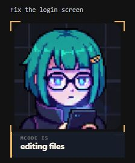

# mcode-emote

i saw the pi-emote avatar and wanted one for mcode too. so i built this.

she sits next to your terminal and reacts when mcode thinks, reads files, writes code, or needs your approval. the little heading shows which chat she's attached to. no extra model calls, no extra command every time. install it once and just run `mcode`.

<p align="center"></p>

*Actual app UI in demo mode, with a sample chat title. No model request behind this screenshot.*

[Install](#install) · [How it works](#how-it-works) · [Limits](#what-still-needs-work) · [Claude version](https://github.com/K-Jadeja/claude-emote)

## Install

Windows x64 beta. You need [MCode](https://github.com/MiniMax-AI/minimax-code), Git, and Node.js 22.19+ (Node 24 recommended). Tested with MCode 0.6.2.

```powershell
git clone https://github.com/K-Jadeja/mcode-emote.git
cd mcode-emote
npm ci
npm run build
npm run overlay:package
node bin/mcode-emote.cjs --emote-install
node scripts/install-mcode-titles.mjs
mcode
```

Restart an already-running MCode session after installation. The plugin starts the pet automatically; **plain `mcode` is enough**. A resumed session may start the pet on its first prompt.

The title step is optional. It backs up your MCode settings and configures a silent status command. It refuses to replace an existing custom status command. Without it, the heading shows the starting folder name. Renames usually appear within about eleven seconds.

Want the optional management command?

```powershell
npm run mcode:install-command
mcode-emote --emote-doctor
```

No npm package or signed installer is published yet. [Full setup and troubleshooting](docs/MCODE_EMOTE.md).

## What she follows

| MCode is doing | Avatar shows |
| --- | --- |
| Starting a session | Greeting |
| Handling your prompt | Thinking |
| Reading files, searching, fetching a page | Reading |
| Editing, writing, applying a patch | Writing |
| Running another tool or a subagent | Using tools |
| Waiting for permission | Needs your input |
| Compacting context | Compacting |
| Finishing a normal turn | Ready |
| Exiting | The pet closes |

Close the pet if you want to keep working without her. She stays dismissed for that MCode process.

## How it works

MCode loads a local plugin that forwards lifecycle hooks to a small companion process. The desktop window uses Neutralinojs and your system WebView, so it doesn't bundle Chromium. No terminal scraping, no second model deciding the animation, and no changes to MCode's installed CLI files.

The activity stream contains only semantic state. Chat titles use MCode's documented status-command interface and a separate authenticated localhost endpoint. Titles can contain text from your initial prompt; message bodies, tool arguments/results, credentials, and full workspace paths are excluded. Nothing is sent to an external service by the avatar.

Updates to MCode should preserve the plugin, but future hook changes can affect compatibility. Run the doctor after updating; the local fixture smoke below checks actual hooks without using model quota.

## What still needs work

- **Speaking:** MCode's plugin hooks don't expose assistant-text streaming, so the pet can't reliably animate speech while the answer prints.
- **Failures and cancellation:** some failed tools and interrupted turns have no matching hook. The pet can retain its last activity until another event arrives.
- **Concurrent work:** the latest observed event drives the pose; this isn't a complete view of every simultaneous subagent.
- **Chat titles:** available in interactive plain MCode. Headless exec and the legacy wrapper keep the folder label.
- **Desktop polish:** signed installer, tray, auto-update, and verified dragging/position persistence are unfinished. Native click-through isn't implemented.

[Binding audit and title verification](docs/incidents/2026-10-03-mcode-bindings-and-chat-titles.md).

## Development and checks

```powershell
npm run typecheck
npm run overlay:typecheck
npm test
npm run verify:upstream
npm run mcode:smoke
```

647 tests passed across 63 files before publication. The real MCode 0.6.2 smoke used an isolated profile and a local model fixture: native startup, reading, normal completion, and cleanup passed. A separate real terminal check verified chat-title delivery and `/rename`. No Claude or MiniMax model quota was used. CI checks the source; native desktop acceptance remains a local check.

The repository retains shared Claude renderer code and tests. [MCode integration guide](docs/MCODE_EMOTE.md) · [Visual sources](docs/VISUALS.md) · [Publication notes](docs/PUBLICATION.md).

## Credits

Inspired by and adapted from [pi-emote](https://github.com/JarodMica/jarods-pi-extensions/tree/main/extensions/pi-emote), originally by [CGx](https://github.com/cgxeiji). The character art and animation engine come from that project. MCode integration and the desktop companion are maintained here by [K-Jadeja](https://github.com/K-Jadeja).

MIT. Original attribution and the immutable upstream snapshot are retained in [THIRD_PARTY_NOTICES.md](THIRD_PARTY_NOTICES.md).
